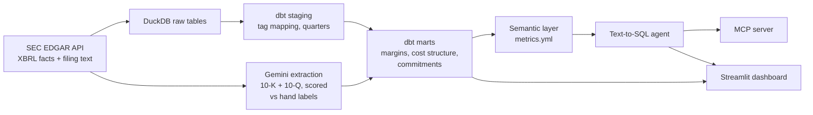

# Margin Squeeze: is AI eating SaaS margins?


**Live dashboard:** [ai-saas-analysis.streamlit.app](https://ai-saas-analysis-hifnx6e7ykpytjicp3gd6b.streamlit.app/)
(the free host sleeps when idle; click "wake up" and give it ~30 seconds)

Software used to be almost free to deliver once it was built: 75–80 cents of every dollar stayed as gross profit.
AI changes that, because every AI answer runs a model on rented GPUs, so cost grows with usage again. This project
tests whether that is showing up in the numbers of 25 public SaaS companies, using their SEC filings from fiscal
2022 (the last year before ChatGPT) to the latest twelve months (through mid-2026).

## Findings

**1. Not yet, at least not in gross margin.** The median company's gross margin is **up 155 basis points**
(1.55 points) since FY2022, and 18 of 25 improved. Five companies (Salesforce, Snowflake, HubSpot, Zoom, Duolingo)
say in their filings that AI is raising their costs now, and four of those five still grew their margins.
Snowflake's AI and GPU cloud costs rose $113.6M in a single quarter while its margin rose 4.6 points, because
revenue (+32%) outgrew delivery costs (+30%).

**2. AI was paid for with people.** At the median company, sales & marketing, R&D and G&A fell **15.6 points of
revenue** combined, and operating margin rose at 22 of 25. The cost-cutting since 2023 made room for AI
spending, but that lever can't be pulled again.

**3. The real exposure is in cloud commitments.** Purchase obligations, mostly multi-year cloud contracts that
must be paid whether the capacity is used or not, rose from **$13.6B to $25.7B** at the 11 companies that report
them in both years (+44% excluding ServiceNow, whose commitments grew from $1.3B to $7.9B, 54% of a year's
revenue). These costs reach the margin only as they're consumed, so they lead it.

Also worth knowing:
- **The biggest margin drops aren't blamed on AI.** Cloudflare (−357 bps), ServiceNow (−352) and Asana (−217)
  don't name AI as the cause; product mix and acquisitions move margins more.
- **Unit costs are falling.** Duolingo, the early example of AI eating margins, now reports "continued reductions
  in per-unit third-party AI costs." The risk is usage growing faster than prices fall.
- **The payoff so far looks positive.** Revenue growth sped up at 17 of 25 companies, and contracted backlog (RPO)
  is growing faster than revenue at 14 of 22.
- **Reading only annual reports undercounts.** The 10-Ks alone show 3 companies citing AI costs; the newer 10-Qs
  add Salesforce and Zoom.

**What to do about it** (detailed on the dashboard's *Findings & playbook* page): price AI on usage rather than
seats, route routine work to the cheapest model that's accurate enough, track AI cost per customer, and compare
cloud commitments with contracted revenue.

These are associations plus what companies say, not proof that AI caused any change. See [Limits](#limits).

## How it's built



| Layer | What it does | Key numbers |
|---|---|---|
| **Ingestion** (`fetch_sec.py`) | Pulls XBRL financial facts and the cost and AI sections of each company's latest 10-K and 10-Q from SEC EDGAR | 25 companies, 19,356 facts, 50 filings |
| **Warehouse** (`warehouse/`, dbt + DuckDB) | Maps each company's XBRL tags to standard line items, rebuilds quarters from year-to-date figures (Q4 = annual − Q1–Q3), and builds trailing-twelve-month marts | 76 tests passing |
| **AI extraction** (`ai/`) | Gemini reads each filing and fills a fixed form (does AI raise costs now, main cost driver, AI revenue, cost trend) with a quote that's verified word-for-word against the filing | 86.7% accurate on 10 hand-labeled filings |
| **Model choice** (`ai/eval.py`) | Runs the same extraction on three Gemini models, logging tokens, cost and latency | Cheapest model was the most accurate and 11× cheaper than the top model ($0.0011 per filing) |
| **Semantic layer + agent** (`semantic/`, `agent/`) | Natural-language questions become SQL over defined metrics only, with a read-only guard and retry on error | 15/15 on a held-out test set, $0.009 total |
| **MCP server** (`mcp_server.py`) | Exposes the metrics, SQL and agent as tools for AI assistants like Cursor | 3 tools |
| **Dashboard** (`streamlit_app.py`) | Overview, cost structure and commitments, findings and playbook, company drilldown, disclosures, ask-the-data chat, AI cost tracking, FAQ | 8 pages |

All AI calls for the whole project cost **$0.28** at paid-tier list prices (118 extraction calls); it ran on
Gemini's free tier.

### Data decisions worth knowing

- **GAAP, not non-GAAP.** Margins come straight from SEC filings, so they include stock comp and acquired-technology
  amortization and run a few points below the figures in earnings releases.
- **Each company's own fiscal year.** FY2022 ends between January and December 2022 depending on the company.
- **Purchase commitments** use the larger of two XBRL tags on each date, because companies use the same tag for one
  small contract in some 10-Qs and the full contractual-obligations table in 10-Ks. Year-end figures are preferred
  and anything more than 15 months stale is dropped.
- **Human review.** Labels were checked against the filing text (5 corrected before final scoring), and one model
  answer (Atlassian) is overridden by hand in `warehouse/seeds/ai_disclosure_reviews.csv` with the reason.

## Run it yourself

Requires Python 3.12+.

```powershell
python -m venv .venv
.\.venv\Scripts\Activate.ps1          # macOS/Linux: source .venv/bin/activate
pip install -r requirements.txt
copy .env.example .env                 # then paste a free Gemini key from aistudio.google.com
streamlit run streamlit_app.py
```

The built warehouse (`warehouse.duckdb`) is committed, so the dashboard works right away. The Gemini key is only
needed for the *Ask the data* page and for rerunning the extraction.

To rebuild from scratch:

```powershell
python fetch_sec.py --email you@example.com      # SEC requires a contact email
cd warehouse; dbt build --profiles-dir .; cd ..
python ai/extract.py --tier cheap --forms 10-K 10-Q
cd warehouse; dbt build --profiles-dir .; cd ..
python ai/eval.py                                 # model accuracy and cost report
python agent/eval_agent.py                        # agent test set
```

## Repo layout

```
fetch_sec.py              SEC download (XBRL facts + filing text)
warehouse/                dbt project: seeds (companies, tag map, reviews), staging, marts
ai/                       Gemini extraction, labeling app, model evaluation
agent/                    text-to-SQL agent and its test questions
semantic/metrics.yml      table, metric and rule definitions the agent is allowed to use
mcp_server.py             MCP server for AI assistants
streamlit_app.py          dashboard
data/                     downloaded facts, filing text, labels and AI logs
VALIDATION.md             hand-checks against filed income statements
```

## Limits

- Companies choose what to disclose, and most group AI compute with general hosting costs, so the true AI share
  of costs is hidden.
- FY2022 to now also covers the post-2022 cost-cutting wave, which moved spending for reasons beyond AI.
- Purchase obligations include non-AI contracts, and 7 of the 25 companies don't tag them.
- 25 hand-picked companies are a sample of large US-listed SaaS, not the whole industry, and there's no
  non-AI control group.
- The data is a snapshot of filings through September 2026, not a live feed.
